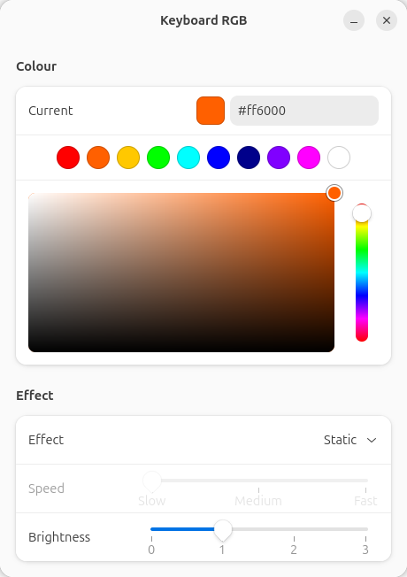

# linux-keyboard-rgb

A small GTK4/libadwaita app for controlling the RGB keyboard backlight on ASUS TUF laptops (and some other ASUS models) on Linux. You can set the colour, effect, speed and brightness. It needs no background service and has no dependencies beyond Python and GTK.

<picture>
  <source media="(prefers-color-scheme: dark)" srcset="docs/screenshot-dark.png">
  
</picture>

## Features

- Colour picker with a saturation/intensity square, hue bar, hex entry and 10 preset colours
- Effects: Static, Breathing, Colour cycle, Strobe
- Speed (Slow / Medium / Fast) and brightness controls
- Changes show on the keyboard as you make them
- Settings are saved to keyboard firmware, so they survive reboots and apply before you log in
- Follows the system light/dark theme

## Supported hardware

The app works on any laptop where the kernel's `asus-wmi` driver provides this file:

```
/sys/class/leds/asus::kbd_backlight/kbd_rgb_mode
```

To check your laptop:

```bash
ls /sys/class/leds/asus::kbd_backlight/kbd_rgb_mode
```

If the file exists, the app should work. If it doesn't, the app can't control your keyboard's colour.

| Hardware | Status |
|---|---|
| ASUS TUF Gaming A15 FA506NCR | Tested |
| Other ASUS TUF models with single-zone RGB (e.g. FA506, FA507, FX506, FX507, FA617) | Expected to work if the file above exists |
| ASUS ROG laptops with per-key / Aura RGB | Not supported: these control the keyboard over USB HID. Use [asusctl](https://gitlab.com/asus-linux/asusctl) instead |
| ASUS laptops with a single-colour backlight | Not supported: only brightness is available, not colour |
| Non-ASUS laptops | Not supported |

Effects can behave differently between models because each one's firmware handles them. For example, the Strobe effect is the driver's catch-all mode, and other firmware may not strobe.

## Requirements

- Linux 5.19 or newer (the version where `kbd_rgb_mode` was added to `asus-wmi`)
- Python 3
- GTK 4.12 or newer, and libadwaita 1.4 or newer
- PyGObject
- udev and `sudo` (used by the installer)

These versions rule out Ubuntu 22.04, Debian 12 and older releases. Ubuntu 24.04+, Debian 13+, Fedora 39+, Arch, openSUSE Tumbleweed and Linux Mint 22+ meet them.

Tested on Ubuntu 26.04 (kernel 7.0, GNOME on Wayland).

## Installation

### 1. Install dependencies

Ubuntu / Debian / Linux Mint:

```bash
sudo apt install python3-gi gir1.2-gtk-4.0 gir1.2-adw-1
```

Fedora:

```bash
sudo dnf install python3-gobject gtk4 libadwaita
```

Arch / Manjaro:

```bash
sudo pacman -S python-gobject gtk4 libadwaita
```

### 2. Run the installer

```bash
git clone https://github.com/fayazsadiq1997-sys/linux-keyboard-rgb.git
```

```bash
cd linux-keyboard-rgb && ./install.sh
```

Run the installer as your normal user, not with `sudo`. It asks for your password only for the system-wide steps.

The installer does the following:

| What | Where |
|---|---|
| Copies the app | `~/.local/bin/linux-keyboard-rgb` |
| Adds a launcher | `~/.local/share/applications/linux-keyboard-rgb.desktop` |
| Adds the icon | `~/.local/share/icons/hicolor/scalable/apps/linux-keyboard-rgb.svg` |
| Creates the `kbdlight` group and adds you to it | system |
| Installs a udev rule that lets the `kbdlight` group write to the keyboard LED files | `/etc/udev/rules.d/99-linux-keyboard-rgb.rules` |

### 3. Reboot

Reboot so the new group membership takes effect. Logging out may not be enough.

## Usage

Open **Keyboard RGB** from your app launcher, or run `linux-keyboard-rgb` from a terminal (needs `~/.local/bin` on your `PATH`).

- **Colour**: click a preset swatch, drag in the square and on the hue bar, or type a hex code such as `#ff6000`. Colour is disabled when the effect is Colour cycle.
- **Effect**: choose Static, Breathing, Colour cycle or Strobe.
- **Speed**: applies to every effect except Static.
- **Brightness**: from 0 (off) to the keyboard's maximum.

Changes show on the keyboard as you make them. Five seconds after your last change, or when you close the window, the settings are saved to the keyboard firmware.

Brightness is set through a separate kernel file and isn't stored in firmware. Your desktop or `systemd-backlight` may restore it at boot instead.

## How it works

The app writes to two sysfs files under `/sys/class/leds/asus::kbd_backlight/`:

- `kbd_rgb_mode` takes `cmd mode red green blue speed`. `cmd` 0 applies the setting until reboot. `cmd` 1 also saves it to firmware.
- `brightness` takes a number from 0 to `max_brightness`.

`kbd_rgb_mode` is write-only, so the app keeps the last colour and effect in `~/.config/linux-keyboard-rgb/settings.json` and loads them when it starts.

Normally only root can write to these files. The udev rule changes their group to `kbdlight` and makes them group-writable, so the app never needs to run as root.

## Troubleshooting

**"No write access. Run install.sh, then reboot."**
Your session isn't in the `kbdlight` group yet. Run `id -nG` and check that `kbdlight` is listed. If it isn't, reboot. Then check the file permissions:

```bash
ls -l /sys/class/leds/asus::kbd_backlight/
```

`kbd_rgb_mode` and `brightness` should show group `kbdlight` with group write permission.

**"Keyboard RGB interface not found"**
`kbd_rgb_mode` doesn't exist. Either your keyboard isn't supported (see [Supported hardware](#supported-hardware)), or the `asus_wmi` module isn't loaded. Check with `lsmod | grep asus_wmi`.

**The app doesn't start**
Run `linux-keyboard-rgb` in a terminal to see the error. A `ValueError: Namespace Adw not available` or an `AttributeError` mentioning `ToolbarView` or `load_from_string` means your GTK or libadwaita is too old (see [Requirements](#requirements)).

## Uninstall

```bash
rm ~/.local/bin/linux-keyboard-rgb ~/.local/share/applications/linux-keyboard-rgb.desktop ~/.local/share/icons/hicolor/scalable/apps/linux-keyboard-rgb.svg
```

```bash
rm -r ~/.config/linux-keyboard-rgb
```

```bash
sudo rm /etc/udev/rules.d/99-linux-keyboard-rgb.rules && sudo udevadm control --reload
```

```bash
sudo gpasswd -d "$USER" kbdlight && sudo groupdel kbdlight
```

The last colour saved to firmware stays on the keyboard after you uninstall.

## License

[MIT](LICENSE)
